# Architecture

The `receiver` service is designed to be used as a publisher, which means it requires a set of consumers to work as intended. The workflow goes as follows:

1) a `consumer` notifies the `receiver` with a so called `ConsumerManifest`, which basically contains a list of sources the consumer is interested in.
2) the `receiver` registers the consumer, and (if necessary) also sets up a subscription to an altinn app
3) the `receiver` will from now on be ready to receive messages / documents from these sources and:

- process these messages (virus scan / document storage / persistence of structured data)
- notify all consumers if a new message is available

4) each `consumer` is (technically) responsible on its own to read / consume messages from valkey. But the `Arbeidstilsynet.Receiver` nuget package will provide convenience methods and extensions to fix this.

The following diagram illustrates with which kind of external services the **receiver** app communicates:



## Event driven `Melding` distribution



## Document soft deletion

Only attachments can be soft-deleted. All applications and message sources are supported.
Deleting main content or structured data returns `400 Bad Request` with an explanation.
The database row, metadata, and stored file are retained; nothing is deleted in Altinn.
Deletion and restoration do not publish a new message notification.

The cluster-internal maintenance endpoints are:

- `POST /meldinger/{meldingId}/attachment-detachments` to soft-delete an attachment.
- `POST /meldinger/{meldingId}/attachment-restorations` to undo deletion.

Both accept the same JSON body and default to a preview without changing anything:

```json
{ "documentId": "00000000-0000-0000-0000-000000000001" }
```

The response contains `revision`, `attachmentIdsBefore`, `attachmentIdsAfter`, and
`alreadyDetached` (the deletion state before the operation). To apply the preview,
send the same document ID with `apply: true` and `expectedRevision`:

```json
{
  "documentId": "00000000-0000-0000-0000-000000000001",
  "apply": true,
  "expectedRevision": "sha256:<revision from preview>"
}
```

Missing revisions on apply return `400`; stale revisions return `409 Conflict`. Preview
again after a conflict. Applying with the current revision is idempotent: deleting an
already-deleted attachment or restoring an active document changes nothing. Restoring
active main content or structured data is also a no-op. Unknown meldinger return `404`;
unknown documents or documents belonging to another melding return `400`.

Deleted attachments are excluded from document listings and from attachment IDs on melding
listings and lookups by default. Document metadata lookups and downloads return `404` for
deleted attachments.

The `includeDeleted` query parameter is optional and defaults to `false`.
Add `?includeDeleted=true` to opt in on these reads:

- `GET /meldinger` (including paginated results)
- `GET /meldinger/{meldingId}`
- `GET /meldinger/by-short-id/{shortId}`
- `GET /meldinger/{meldingId}/documents`
- `GET /meldinger/{meldingId}/documents/{documentId}`

Document metadata includes `isDeleted` so callers can identify deleted attachments.
The opt-in does not bypass virus-scan safety checks.

**Downloads do not support `includeDeleted`. Restore the attachment first**, then call
`GET /meldinger/{meldingId}/documents/{documentId}/download`. Passing `includeDeleted=true`
to a download does not make deleted content available.

These operations rely on cluster network access restrictions, not endpoint authentication.
